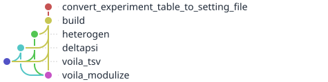
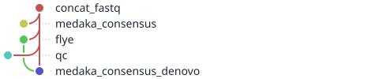
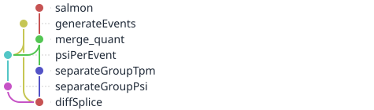
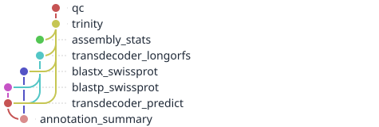
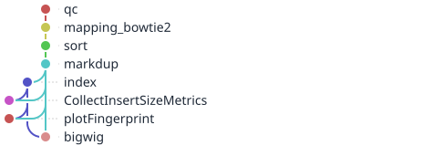
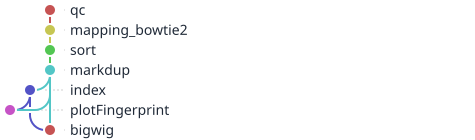
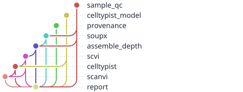
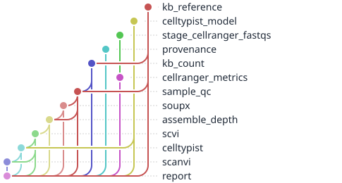

# Pipeline rulegraphs

Generated from the current Snakefiles using Snakemake and [snakevision](https://github.com/OpenOmics/snakevision). The slim view hides the aggregate `all` and `multiqc` nodes; the full graph retains every rule. These are representative configurations, not a union of every optional setting.

## LeafCutter

### LeafCutter

[Full SVG](assets/rulegraphs/LeafCutter.svg) · [DOT source](assets/rulegraphs/LeafCutter.dot)

## MAJIQ

### MAJIQ

[Full SVG](assets/rulegraphs/MAJIQ.svg) · [DOT source](assets/rulegraphs/MAJIQ.dot)

## ONT_plasmid_assembly

### ONT_plasmid_assembly

[Full SVG](assets/rulegraphs/ONT_plasmid_assembly.svg) · [DOT source](assets/rulegraphs/ONT_plasmid_assembly.dot)

## STARsolo

### STARsolo

[Full SVG](assets/rulegraphs/STARsolo.svg) · [DOT source](assets/rulegraphs/STARsolo.dot)

## SUPPA2_diffSplice

### SUPPA2_diffSplice

[Full SVG](assets/rulegraphs/SUPPA2_diffSplice.svg) · [DOT source](assets/rulegraphs/SUPPA2_diffSplice.dot)

## Whippet

### Whippet

[Full SVG](assets/rulegraphs/Whippet.svg) · [DOT source](assets/rulegraphs/Whippet.dot)

## bam2bw_RNAseq

### bam2bw_RNAseq

[Full SVG](assets/rulegraphs/bam2bw_RNAseq.svg) · [DOT source](assets/rulegraphs/bam2bw_RNAseq.dot)

## bam2cram

### bam2cram

[Full SVG](assets/rulegraphs/bam2cram.svg) · [DOT source](assets/rulegraphs/bam2cram.dot)

## callpeak_ATACseq

### callpeak_ATACseq

[Full SVG](assets/rulegraphs/callpeak_ATACseq.svg) · [DOT source](assets/rulegraphs/callpeak_ATACseq.dot)

## callpeak_ChIPseq

### callpeak_ChIPseq

[Full SVG](assets/rulegraphs/callpeak_ChIPseq.svg) · [DOT source](assets/rulegraphs/callpeak_ChIPseq.dot)

## cellranger_count

### cellranger_count

[Full SVG](assets/rulegraphs/cellranger_count.svg) · [DOT source](assets/rulegraphs/cellranger_count.dot)

## denovo_assembly_RNAseq

### denovo_assembly_RNAseq_paired

[Full SVG](assets/rulegraphs/denovo_assembly_RNAseq_paired.svg) · [DOT source](assets/rulegraphs/denovo_assembly_RNAseq_paired.dot)

### denovo_assembly_RNAseq_single

[Full SVG](assets/rulegraphs/denovo_assembly_RNAseq_single.svg) · [DOT source](assets/rulegraphs/denovo_assembly_RNAseq_single.dot)

## differential_ATACseq

### differential_ATACseq

[Full SVG](assets/rulegraphs/differential_ATACseq.svg) · [DOT source](assets/rulegraphs/differential_ATACseq.dot)

## footprinting_ATACseq

### footprinting_ATACseq

[Full SVG](assets/rulegraphs/footprinting_ATACseq.svg) · [DOT source](assets/rulegraphs/footprinting_ATACseq.dot)

## footprinting_timeseries_ATACseq

### footprinting_timeseries_ATACseq

[Full SVG](assets/rulegraphs/footprinting_timeseries_ATACseq.svg) · [DOT source](assets/rulegraphs/footprinting_timeseries_ATACseq.dot)

## kb-nac

### kb_nac

[Full SVG](assets/rulegraphs/kb_nac.svg) · [DOT source](assets/rulegraphs/kb_nac.dot)

## preprocessing_CLIPseq

### preprocessing_CLIPseq_HITSCLIP

[Full SVG](assets/rulegraphs/preprocessing_CLIPseq_HITSCLIP.svg) · [DOT source](assets/rulegraphs/preprocessing_CLIPseq_HITSCLIP.dot)

### preprocessing_CLIPseq_iCLIPseq

[Full SVG](assets/rulegraphs/preprocessing_CLIPseq_iCLIPseq.svg) · [DOT source](assets/rulegraphs/preprocessing_CLIPseq_iCLIPseq.dot)

## preprocessing_ChIPseq

### preprocessing_ChIPseq_paired

[Full SVG](assets/rulegraphs/preprocessing_ChIPseq_paired.svg) · [DOT source](assets/rulegraphs/preprocessing_ChIPseq_paired.dot)

### preprocessing_ChIPseq_single

[Full SVG](assets/rulegraphs/preprocessing_ChIPseq_single.svg) · [DOT source](assets/rulegraphs/preprocessing_ChIPseq_single.dot)

## preprocessing_RNAseq_long

### preprocessing_RNAseq_long

[Full SVG](assets/rulegraphs/preprocessing_RNAseq_long.svg) · [DOT source](assets/rulegraphs/preprocessing_RNAseq_long.dot)

## preprocessing_RNAseq

### preprocessing_RNAseq_paired

[Full SVG](assets/rulegraphs/preprocessing_RNAseq_paired.svg) · [DOT source](assets/rulegraphs/preprocessing_RNAseq_paired.dot)

### preprocessing_RNAseq_single

[Full SVG](assets/rulegraphs/preprocessing_RNAseq_single.svg) · [DOT source](assets/rulegraphs/preprocessing_RNAseq_single.dot)

## rMATS

### rMATS

[Full SVG](assets/rulegraphs/rMATS.svg) · [DOT source](assets/rulegraphs/rMATS.dot)

## scrna_seq

### scrna_seq_counts

[Full SVG](assets/rulegraphs/scrna_seq_counts.svg) · [DOT source](assets/rulegraphs/scrna_seq_counts.dot)

### scrna_seq_fastq

[Full SVG](assets/rulegraphs/scrna_seq_fastq.svg) · [DOT source](assets/rulegraphs/scrna_seq_fastq.dot)
