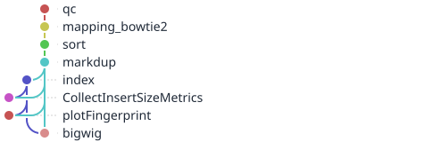

# preprocessing_ChIPseq.smk

<!-- rulegraphs:start -->

**preprocessing_ChIPseq_paired**



[Animated graph](../assets/rulegraphs/preprocessing_ChIPseq_paired.slim.animated.svg) · [Full graph](../assets/rulegraphs/preprocessing_ChIPseq_paired.svg) · [Graph generation](../rulegraphs-maintenance.md)

**preprocessing_ChIPseq_single**


[Animated graph](../assets/rulegraphs/preprocessing_ChIPseq_single.slim.animated.svg) · [Full graph](../assets/rulegraphs/preprocessing_ChIPseq_single.svg) · [Graph generation](../rulegraphs-maintenance.md)

<!-- rulegraphs:end -->

Snakemake workflow for preprocessing **paired-end** and **single-end** ChIP-seq/ATAC-seq data. The `layout` parameter in the config file controls the mode.

!!! note

    Please make sure that you have [Singularity](https://sylabs.io/guides/3.7/user-guide/quick_start.html) and [Snakemake](https://snakemake.readthedocs.io/en/stable/) installed on your system and cloned the [SnakeNgs](https://github.com/Sika-Zheng-Lab/SnakeNgs) repository.

!!! note "RustQC support"

    RustQC v0.2.1 only implements RNA alignment QC and requires a GTF annotation.
    It has no ChIP/ATAC mode or fingerprint equivalent. This workflow therefore
    retains fastp, Picard insert-size QC and deepTools fingerprinting. See the
    [RNA-seq migration notes](preprocessing_RNAseq.md#rustqc-configuration-and-outputs).

## Workflow

### Paired-end (`layout: "paired"`)

1. Quality control using [fastp](https://github.com/OpenGene/fastp) with the default parameters.
2. Alignment using [Bowtie2](http://bowtie-bio.sourceforge.net/bowtie2/index.shtml) with the parameter specified in the `config.yaml`.
3. Convert the SAM file to BAM file and sort using [samtools](http://www.htslib.org/).
4. Remove duplicates using [Picard](https://broadinstitute.github.io/picard/) `MarkDuplicates` with the parameter `--REMOVE_DUPLICATES true`.
5. Collect metrics using [Picard](https://broadinstitute.github.io/picard/) `CollectInsertSizeMetrics`.
6. Make fingerprint plots using [deepTools](https://deeptools.readthedocs.io/en/develop/) `plotFingerprint` with the parameter `--minMappingQuality 30 --skipZeros --numberOfSamples 50000 --binSize 10000`.
7. Make bigWig files using [deepTools](https://deeptools.readthedocs.io/en/develop/) `bamCoverage` with the parameter `--binSize 1 --normalizeUsing CPM`.
8. Make summary statistics using [MultiQC](https://multiqc.info/).

### Single-end (`layout: "single"`)

1. Quality control using [fastp](https://github.com/OpenGene/fastp) with the default parameters.
2. Alignment using [Bowtie2](http://bowtie-bio.sourceforge.net/bowtie2/index.shtml) with the parameter specified in the `config.yaml`.
3. Convert the SAM file to BAM file and sort using [samtools](http://www.htslib.org/).
4. Remove duplicates using [Picard](https://broadinstitute.github.io/picard/) `MarkDuplicates` with the parameter `--REMOVE_DUPLICATES true`.
5. Make fingerprint plots using [deepTools](https://deeptools.readthedocs.io/en/develop/) `plotFingerprint` with the parameter `--minMappingQuality 30 --skipZeros --numberOfSamples 50000 --binSize 10000`.
6. Make bigWig files using [deepTools](https://deeptools.readthedocs.io/en/develop/) `bamCoverage` with the parameter `--binSize 1 --normalizeUsing CPM`.
7. Make summary statistics using [MultiQC](https://multiqc.info/).

## Usage

``` bash
snakemake -s /path/to/SnakeNgs/snakefile/preprocessing_ChIPseq.smk \
--configfile /path/to/config.yaml \
--cores <int> \
--use-singularity \
--rerun-incomplete
```

`config.yaml` should contain the following information:

### Paired-end

``` yaml
workdir: path/to/output
samples: ["SRRXXXXXX", "SRRYYYYYY", "SRRZZZZZZ"]
bowtie2_index: path/to/bowtie2_index
bowtie2_args: ""
layout: "paired"
```

- `path/to/output` should contain `fastq` directory with the following structure:

``` bash
output/
└── fastq
    ├── SRRXXXXXX_1.fastq.gz
    ├── SRRXXXXXX_2.fastq.gz
    ├── SRRYYYYYY_1.fastq.gz
    ├── SRRYYYYYY_2.fastq.gz
    ├── SRRZZZZZZ_1.fastq.gz
    └── SRRZZZZZZ_2.fastq.gz
```

### Single-end

``` yaml
workdir: path/to/output
samples: ["SRRXXXXXX", "SRRYYYYYY", "SRRZZZZZZ"]
bowtie2_index: path/to/bowtie2_index
bowtie2_args: ""
layout: "single"
```

- `path/to/output` should contain `fastq` directory with the following structure:

``` bash
output/
└── fastq
    ├── SRRXXXXXX.fastq.gz
    ├── SRRYYYYYY.fastq.gz
    └── SRRZZZZZZ.fastq.gz
```

### Common settings

- `bowtie2_args` is the optional argument for Bowtie2 (e.g., `--very-sensitive`).

Please refer to the [tutorial](../tutorial/ChIP-ATAC_preprocessing_callpeak.md) for more information.

## Docker image used in the workflow

- [quay.io/biocontainers/fastp:0.23.4--hadf994f_2](https://quay.io/repository/biocontainers/fastp)
- [quay.io/biocontainers/bowtie2:2.5.2--py39h6fed5c7_0](https://quay.io/repository/biocontainers/bowtie2)
- [quay.io/biocontainers/samtools:1.18--h50ea8bc_1](https://quay.io/repository/biocontainers/samtools)
- [quay.io/biocontainers/picard:3.1.1--hdfd78af_0](https://quay.io/repository/biocontainers/picard)
- [quay.io/biocontainers/deeptools:3.5.4--pyhdfd78af_1](https://quay.io/repository/biocontainers/deeptools)
- [multiqc/multiqc:v1.35](https://hub.docker.com/r/multiqc/multiqc)
